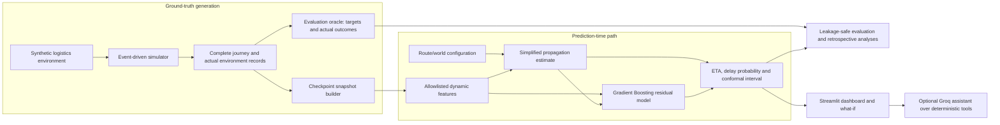

# Aiqon Shipment Intelligence Engine

The Aiqon Shipment Intelligence Engine is a reproducible, synthetic shipment ETA and delay-propagation project. It generates complete shipment journeys, builds information-safe snapshots at three decision times, evaluates five ETA approaches, and provides a Streamlit dashboard with an optional tool-grounded AI assistant.

All three route profiles and every generated shipment, operating condition, forecast and outcome are synthetic. The assignment suggested roughly 100–300 shipment records; this implementation uses **300 unique journeys and 900 checkpoint snapshots**. Its metrics demonstrate behavior under this simulator and do not establish real-world shipment accuracy.

## Problem and capabilities

Shipment delays move through connected stages. A small transit delay can cross a berth slot, meet a vessel queue, reach a weekend customs closure or miss a truck dispatch cutoff. The project models these interactions and asks what an ETA system can predict using only information available at each checkpoint.

- Event-driven ground-truth simulation with four nonlinear mechanisms: berth slot waits, berth queues, weekend customs closures and inland gate cutoffs.
- Departure, port-arrival and customs-cleared snapshots with eligible forecast vintages and explicit feature allowlists.
- Scheduled ETA, carry-forward, propagation-only, ML-only Gradient Boosting and hybrid propagation-plus-residual predictions.
- Shipment-grouped fit/calibration/test evaluation, split conformal intervals, empirical delay probabilities and separate explanation methods.
- Streamlit views for overview, shipment detail, explainability and in-memory what-if scenarios.
- Optional Groq tool-calling assistant. The core system works without credentials or network access.

## Architecture and information boundaries



The simulator may use realized future conditions to create the outcome. The feature builder consumes checkpoint snapshots, shipment schedule metadata and route/world configuration; it does not receive the complete event log or actual future environment table. Evaluation targets are stored separately. Retrospective simulator attribution, as-of prediction-driver sensitivity, and SHAP residual contributions are distinct analyses.

## Technology and repository map

Python, Pydantic, YAML, NumPy, Pandas, PyArrow, scikit-learn, SHAP, Streamlit, Plotly and pytest. The saved model bundles were created with Python 3.13.1, NumPy 2.1.1, pandas 2.2.3, scikit-learn 1.6.1, joblib 1.4.2, Matplotlib 3.10.1 and SHAP 0.47.2. The declared dependency constraints retain those artifact versions; model loading also validates Python major/minor, scikit-learn and joblib compatibility.

```text
IMPLEMENTATION.md                 authoritative phase and contract specification
configs/                          simulation and three synthetic route profiles
data/raw/                         shipments, actual events, actual environment, forecasts
data/processed/                   checkpoint snapshots and separate target table
artifacts/models/                 Phase 2 and Phase 3 bundles, calibration and metadata
reports/metrics/                  dataset summary, evaluation, splits and attribution
reports/figures/                  existing Phase 3 evaluation figures
docs/architecture.md              final architecture and information boundaries
docs/data_dictionary.md           artifact grains, schemas and feature status
reports/technical_report.md       editable submission report
reports/technical_report.pdf      three-page formatted submission report
src/aiqon/                        schemas, generation, prediction, evaluation, dashboard and agent
tests/                            unit and integration coverage
app.py                            Streamlit entry point
```

## Runtime and installation

Use **Python 3.13.x** for this submission and its checked-in model artifacts. `pyproject.toml` enforces `>=3.13,<3.14`; the model metadata records training on 3.13.1 and the loaders require a compatible Python major/minor, scikit-learn and joblib runtime. Python 3.10 is unsupported; Python 3.11/3.12 may run portions of the source but cannot load these saved bundles under the runtime checks.

PowerShell from the repository root:

```powershell
py -3.13 -m venv .venv
.\.venv\Scripts\Activate.ps1
python -m pip install -r requirements.txt
```

`requirements.txt` installs the editable package with its `dev` and optional `assistant` extras from `pyproject.toml`; this supports the complete test suite, including local Groq adapter tests, without requiring a key or making API calls. For a core-only installation without the Groq SDK or `python-dotenv`, use `python -m pip install .`. The dashboard, data generation, prediction and evaluation do not need the assistant extra; if `python-dotenv` is absent, agent settings are read from process environment variables.

Validate configuration and the checked-in Phase 2 prediction artifact:

```powershell
python -c "from aiqon.config.loader import load_config, load_routes; print(load_config('configs/simulation.yaml').data); print(len(load_routes('configs/routes.yaml').routes))"
python -m aiqon.prediction.service SHP-0001 --checkpoint departure --variant hybrid
```

The latter command appends a prediction record to `artifacts/prediction_history.jsonl`. Commands that generate data, train models or evaluate Phase 3 write to their selected output paths; back up accepted artifacts before intentionally replacing them.

## Data generation, training and evaluation

Generate the configured 300-journey cohort (this replaces the current dataset files under `data/` and its dataset summary):

```powershell
python -m aiqon.data_generation.generator --config configs/simulation.yaml --routes configs/routes.yaml --output-root .
```

Train Phase 2 candidate models and run the preliminary grouped validation:

```powershell
python -m aiqon.prediction.training --data-root . --config configs/simulation.yaml --routes configs/routes.yaml --artifact-dir artifacts/models
```

The command writes `phase2_bundle.joblib`, `phase2_metadata.json` and `reports/metrics/phase2_preliminary.json`. Phase 3 performs the fixed 70/15/15 shipment-level fit/calibration/test evaluation and writes its metrics, figures and separate calibrated bundle:

```powershell
python -m aiqon.evaluation.phase3 --data-root . --config configs/simulation.yaml --routes configs/routes.yaml --artifact-dir artifacts/models
```

For an individual Phase 2 prediction:

```powershell
python -m aiqon.prediction.service SHP-0001 --checkpoint departure --variant hybrid
```

The verified five-minute local dashboard flow is documented in [the demo script](reports/demo_script.md).

## Current Phase 3 evaluation

The stored evaluation uses 210 fit, 45 calibration and 45 test shipments. Every shipment's three snapshots stay in one partition; all five approaches are measured on the same test set. MAE and RMSE are hours (`n=45` at each checkpoint); values below are copied from `reports/metrics/phase3_comparison.csv`.

| Approach | Departure MAE / RMSE | Port-arrival MAE / RMSE | Customs-cleared MAE / RMSE |
|---|---:|---:|---:|
| Scheduled ETA | 50.20 / 66.68 | 50.20 / 66.68 | 28.75 / 32.06 |
| Carry-forward | 50.20 / 66.68 | 50.25 / 66.51 | 22.90 / 35.58 |
| Propagation-only | 31.65 / 49.74 | 25.20 / 37.22 | 10.30 / 14.25 |
| ML-only | 18.06 / 25.38 | 15.01 / 22.27 | 2.21 / 2.91 |
| Hybrid | 18.51 / 25.61 | 12.00 / 15.03 | 6.30 / 7.69 |

Hybrid is strongest on port-arrival MAE but does not beat ML-only at departure or customs clearance. It beats carry-forward at all three checkpoints; this is a result on a single synthetic test split, not evidence that hybrid modeling is generally superior. The 90% nominal normalized split conformal intervals covered 97.8% of departure, 100% of port-arrival and 95.6% of customs-cleared test rows; mean widths were 109.3, 83.3 and 37.3 hours. The intervals are wide and the test set is small. Delay probabilities use checkpoint-specific normalized signed calibration residuals, not the conformal interval as a probability distribution. The test set has only five non-significant shipments per checkpoint, so probability metrics are uncertain.

## Dashboard

Generate the dataset and have the Phase 3 artifacts in place, then run:

```powershell
streamlit run app.py
```

Pages: **Overview**, **Shipment Intelligence**, **Explainability**, **What-if Simulation**, and **AI Assistant**. Historical actual events are labeled retrospective; what-if scenarios are simulated and use copied state. The dashboard reads stored datasets and Phase 3 artifacts; it does not train a model during normal page use.

## Optional AI Assistant

The assistant calls Groq only after a user submits a chat message. The six local, validated tools are the source of numerical evidence. It is optional; the dashboard and core engine do not require Groq, credentials or internet access.

To enable it, install the optional extra with `python -m pip install ".[assistant]"`, copy `.env.example` to `.env`, provide your own `GROQ_API_KEY`, and restart Streamlit. `.env` is ignored by Git; `.env.example` contains only a placeholder. Do not put a real key in the repository. Provider requests can use network access and quota, but ordinary tests skip live Groq checks unless `AIQON_RUN_LIVE_GROQ_TESTS=1` is explicitly set.

## Tests and reproducibility

```powershell
python -m pytest -v
python -m compileall -q src tests app.py
```

Generation uses seed 42 and SHA-256-derived PCG64 streams rather than global random state. The configured journey count, checkpoints and random seed are in `configs/simulation.yaml`; route assumptions are in `configs/routes.yaml`. A smaller test cohort can be created by loading that `SimulationConfig`, making a copy with a smaller `data.n_shipments`, and passing the copy to `generate_dataset(..., route_config_path='configs/routes.yaml', output_root='<temporary-directory>')`. This preserves the accepted 300-journey configuration and outputs.

## Assumptions and limitations

Route labels inspired by Indian logistics identify synthetic corridors; their parameters do not describe real port operations. Four selected mechanisms are modeled, but holidays, equipment failures, real AIS, carrier schedules and external logistics feeds are not. Weather is an observed/forecast feature but does not cause actual simulator transit delay in this implementation. The 12-hour significant-delay threshold is a configurable project assumption, not an industry standard. Split conformal coverage is empirical on a small held-out sample and is not conditional or shift-robust. The derived risk score relies on a small calibration set and an assumed residual scaling relationship. Counterfactual findings depend on this simulator; SHAP explains the residual model rather than causation. See [the technical report](reports/technical_report.md), [architecture](docs/architecture.md), [data dictionary](docs/data_dictionary.md) and [authoritative specification](IMPLEMENTATION.md) for details.
