# Final architecture: Phases 0–5

This document describes the implemented system. Its central boundary is between complete synthetic truth used by simulation/evaluation and checkpoint-scoped information used by prediction. Three route profiles, journey outcomes and forecasts are synthetic assumptions.

## End-to-end architecture

```mermaid
flowchart LR
  subgraph GT[Ground-truth generation]
    C[Simulation and route configuration] --> W[Time-indexed synthetic environment]
    C --> SIM[Event-driven cohort simulator]
    W --> SIM
    SIM --> J[Shipment, actual event, environment and forecast records]
    J --> SNAP[Checkpoint snapshot builder]
    J --> ORACLE[Evaluation oracle<br/>separate actual targets]
  end

  subgraph ASOF[Prediction-time path: no oracle edge]
    SNAP --> AL[Checkpoint allowlists and forecast-vintage checks]
    SH[Shipment schedule metadata] --> FE[Dynamic feature builder]
    AL --> FE
    RC[Route and world configuration] --> PROP[Simplified propagation estimate]
    FE --> PROP
    FE --> GBR[Gradient Boosting residual estimator]
    PROP --> GBR
    PROP --> OUT[Predicted remaining time and ETA]
    GBR --> OUT
    CAL[Phase 3 calibration artifact] --> UNC[Delay-risk approximation and conformal interval]
    OUT --> UNC
  end

  ORACLE --> EV[Evaluation and explainability]
  UNC --> EV
  EV --> DASH[Streamlit dashboard]
  OUT --> DASH
  DASH --> WHATIF[In-memory scenario service]
  DASH --> AGENT[Optional Groq tool-calling assistant]
  AGENT --> TOOLS[Six deterministic read/predict/what-if tools]
  TOOLS --> DASH
```

There is intentionally no edge from the evaluation oracle to the prediction-time path. Actual future events and actual future environment readings generate outcomes and targets; they do not populate earlier prediction features. The simulator and propagation estimator use separate logic.

## Data and prediction flow

1. `configs/simulation.yaml` defines 300 shipments, seed 42, the three checkpoint names, a configurable 12-hour significant-delay threshold, model/evaluation defaults and world settings. `configs/routes.yaml` defines exactly three illustrative synthetic route profiles.
2. `aiqon.data_generation.generator` creates the complete cohort. The simulator produces eight lifecycle events per shipment, route/hour actual environment records, issue-time forecasts, three checkpoint snapshots and a separate target table. Four nonlinear mechanisms are berth slot waits, berth queues, weekend customs closures and inland dispatch cutoffs.
3. `aiqon.checkpoints` and Pydantic schemas validate checkpoint-specific observed event/stage/environment fields and forecast issuance time. Forecast issue time must be no later than the checkpoint. Forecast valid time is retained independently. The feature builder uses only the snapshot, schedule metadata, and configured route/world parameters.
4. Phase 2 offers five approaches: scheduled ETA, carry-forward delay, propagation-only, direct ML-only and hybrid. The shared Gradient Boosting residual model predicts the difference between actual remaining hours and the simplified propagation estimate. The operational remaining-time prediction is nonnegative and ETA is checkpoint time plus predicted remaining hours.
5. Phase 3 assigns shipment IDs to disjoint 70% fit, 15% calibration and 15% test sets before expanding their checkpoint snapshots. It fits model transformations on fit shipments only; normalized conformal calibration and the empirical normalized signed-residual delay-probability approximation use calibration shipments; held-out metrics use the untouched test group. Bootstrap draws resample whole shipments and retain all three checkpoints.
6. The dashboard reconstructs prediction outputs from the separate Phase 3 bundle and calibration artifact. What-if transformations run on copied in-memory snapshots/configuration and do not write to training inputs or prediction records.
7. The optional Phase 5 assistant is disabled without a key and makes no request on app start or navigation. It can only call the six statically registered tools. Numerical claims must come from those tools.

## Checkpoint information policy

| Checkpoint | Observed events and state | Allowed future inputs | Still hidden |
|---|---|---|---|
| `departure` | Departure trigger, shipment/route/schedule, origin observations | Forecasts issued at or before departure; published route calendars | Port arrival, queue/berth outcomes, customs processing, future actual conditions, delivery and targets |
| `port_arrival` | Departure and arrival triggers, transit duration/disruption, arrival queue and berth availability | Eligible port, customs and inland forecasts | Berth completion/service draw, customs outcome, future realized conditions and delivery |
| `customs_cleared` | Earlier observed events and actual customs completion/duration, contemporaneous inland/gate state | Eligible inland forecast | Gate-out, delivery and future actual conditions |

The customs-cleared snapshot does not contain a queue placeholder; route-global queue state is observed only at port arrival where it is measured. `truck_availability=1.0` is a constant assumption because the simulator has no separate truck shortage/failure process. `gate_out` and `delivery` are evaluation-only events.

## Modeling and explanation boundaries

- **Ground truth:** sequential event simulation using actual conditions at actual event times, seeded random draws and route calendars. `actual_delivery_at` defines final delay and the remaining-duration targets.
- **Prediction:** the propagation model approximates stage durations/windows and consumes a valid eligible forecast, an as-of observation or a documented route fallback. It does not use actual future queue, service draws, events or environment.
- **Delay risk:** checkpoint-specific empirical normalized signed calibration residuals estimate the probability that final delay exceeds the configurable threshold. This is a small-sample approximation, not a direct classifier and not a conformal probability distribution.
- **Uncertainty:** normalized split conformal intervals use absolute residuals with a positive scale floor. The observed coverage is test-set empirical coverage only; no conditional or distribution-shift guarantee is asserted.
- **Retrospective cause attribution:** reruns the full simulator with a realized mechanism neutralized, holding matched random streams where possible. It explains a simulated completed journey, not prior checkpoint knowledge.
- **Prediction-driver attribution:** changes an eligible forecast input for propagation sensitivity. It does not explain realized outcomes.
- **SHAP:** explains the learned residual correction only. Neither SHAP nor synthetic counterfactuals establish real-world causality.
- **Dashboard what-if:** reports a simulated alternate assumption and leaves its source state unchanged.
- **AI assistant:** optional language layer over existing deterministic tools; it does not replace the predictor, access actual outcome attribution, or execute operations.

## Runtime and artifact compatibility

The package runtime for this submission is Python 3.13.x. The checked-in Phase 2 metadata records Python 3.13.1, scikit-learn 1.6.1 and joblib 1.4.2; Phase 3 metadata records those versions plus NumPy 2.1.1, pandas 2.2.3, Matplotlib 3.10.1 and SHAP 0.47.2. Artifact loaders check runtime metadata before deserializing and reject incompatible Python major/minor or scikit-learn versions. The package pins the artifact-sensitive library versions. The Groq SDK and `python-dotenv` are in the optional `assistant` extra; the dashboard core installs and starts without them, and does not need an API key.

## Main implementation map

| Concern | Implemented modules/artifacts |
|---|---|
| Typed schemas and configuration | `src/aiqon/schemas/`, `src/aiqon/checkpoints.py`, `src/aiqon/config/loader.py` |
| Environment, forecasts and full-cohort simulation | `src/aiqon/data_generation/`, `src/aiqon/simulation/` |
| Dynamic features, propagation, Phase 2 training/inference | `src/aiqon/prediction/`, `artifacts/models/phase2_*` |
| Evaluation, calibration and explanations | `src/aiqon/evaluation/`, `artifacts/models/phase3_*`, `reports/metrics/` |
| Read-only dashboard services and pages | `src/aiqon/dashboard/`, `app.py` |
| Optional assistant/provider/tools | `src/aiqon/agent/` |
| Test suite | `tests/unit/`, `tests/integration/` |
