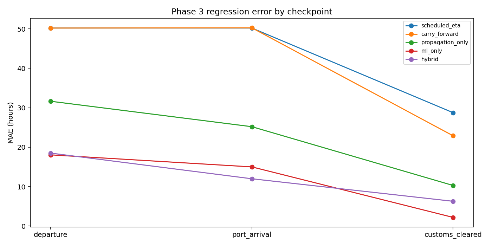
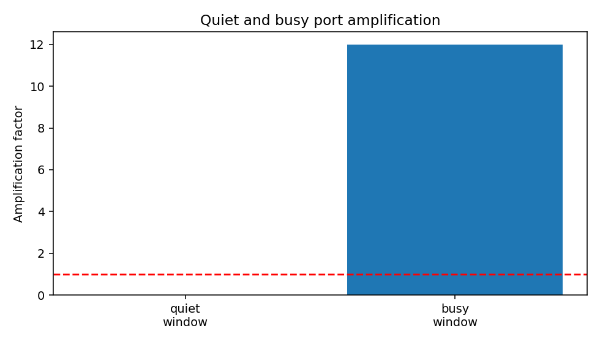

# Aiqon Shipment Intelligence Engine
## Synthetic shipment ETA and delay propagation — technical report

**Submission report · Phase 0–6 · 17 November 2026**

## 1. Problem and objective

Shipment delays propagate through connected stages. A transit delay can alter berth-slot eligibility, vessel queues, customs opening windows and inland dispatch. This project builds a reproducible synthetic environment and compares checkpoint-based remaining-time and final-ETA predictions. It uses exactly **300 unique journeys**, **900 snapshots** (one at each of three checkpoints), and three route profiles. The assignment suggested about 100–300 records; all routes and values here are synthetic and do not represent real ports.

## 2. Synthetic environment and ground truth

The event simulator sequentially produces departure, port arrival, berth start, port completion, customs start, customs completion, gate-out and delivery. Actual environment values are indexed by hourly UTC buckets and read at event time. Seeded random streams drive shipment volume, departure time, transit perturbation, berth service variation, environment innovations and forecast error. The four nonlinear mechanisms are berth slot waits, berth queues/bunching, weekend customs closure and inland gate/truck cutoff. The checked-in dataset contains 2,400 events, 23,013 route/location/hour actual environment rows and 3,000 forecast records.

Ground-truth final delay is `actual_delivery_at - scheduled_delivery_at`; a significant delay is strictly greater than **12 hours**, a configurable project assumption rather than an industry threshold. At checkpoint time `t`, the target is `actual_delivery_at - t`. The complete event/environment tables and the separate target table are evaluation/training truth, not predictor inputs.

## 3. Dynamic checkpoints and leakage control

Predictions occur at departure, port arrival before berth completion, and customs clearance completion. Each Pydantic snapshot includes only allowlisted observed events/stage fields, current observations and forecasts issued no later than its checkpoint. Forecast issue time and valid time are separate. Future actual arrivals, queue/service outcomes, customs outcomes and delivery are hidden until observable; gate-out and delivery are ground-truth-only. `remaining_hours_actual`, total actual delay and the significant-delay label live in a separate 900-row target table.

The 300 shipment IDs are split before snapshot expansion into **210 fit / 45 calibration / 45 test** shipments (70/15/15); all three rows for a shipment remain together. Fit data trains preprocessing and estimators, calibration data supplies per-checkpoint uncertainty/risk calibration, and test data is held out for reported metrics. Bootstrap resampling is by shipment with all checkpoints paired.

## 4. Propagation plus ML residual methodology

The transparent propagation estimate approximates remaining stage durations, berth/queue timing, configured route calendars and inland travel using eligible forecasts, as-of observations and documented configuration fallbacks. It is not a copy of the simulator and never reads hidden future actual conditions or the realized future berth-service draw. A scikit-learn Gradient Boosting regressor predicts the residual `actual remaining hours - propagation remaining hours`; the hybrid ETA adds its predicted residual to propagation and clamps operational remaining time at zero. A second direct Gradient Boosting model provides the ML-only comparator.

The five evaluated approaches are scheduled ETA, carry-forward delay, propagation-only, ML-only and hybrid. Final evaluation uses normalized split conformal calibration by checkpoint, with a 1.0-hour scale floor and 90% nominal coverage. Significant-delay probability is a separate checkpoint-specific empirical normalized signed-calibration-residual estimate; no direct classifier was retained. Its calibration sample is only 45 shipments per checkpoint. The current test sample has 40 significant and five non-significant outcomes per checkpoint.

## 5. Held-out regression results

All values are hours, from the saved Phase 3 comparison artifact; **n=45 test journeys per checkpoint**. Each cell is MAE / RMSE.

| Approach | Departure | Port arrival | Customs cleared |
|---|---:|---:|---:|
| Scheduled ETA | 50.20 / 66.68 | 50.20 / 66.68 | 28.75 / 32.06 |
| Carry-forward | 50.20 / 66.68 | 50.25 / 66.51 | 22.90 / 35.58 |
| Propagation-only | 31.65 / 49.74 | 25.20 / 37.22 | 10.30 / 14.25 |
| ML-only | 18.06 / 25.38 | 15.01 / 22.27 | 2.21 / 2.91 |
| Hybrid | 18.51 / 25.61 | **12.00 / 15.03** | 6.30 / 7.69 |

Propagation reduces MAE relative to carry-forward at each checkpoint. Hybrid reduces carry-forward MAE by 31.69 hours (63.1%) at departure, 38.25 hours (76.1%) at port arrival and 16.60 hours (72.5%) at customs clearance. It is best at port arrival, but ML-only is better at departure and customs clearance. The conclusion is not “hybrid always wins”: stage information and the learned residual matter, and performance varies by checkpoint. These point estimates describe one fixed synthetic test split, not real-world accuracy.

## 6. Risk, uncertainty, explainability and propagation experiments

At a fixed 0.50 decision threshold, the derived significant-delay probabilities had ROC-AUC **0.59 / 0.82 / 1.00** and Brier score **0.106 / 0.082 / 0.016** for departure / port arrival / customs clearance. Precision/recall/F1 were **0.907/0.975/0.940**, **0.907/0.975/0.940** and **1.000/1.000/1.000**. The small 45-record samples and only five negative labels make these probability results uncertain; ROC-AUC 1.00 at customs is not a generalization claim.

Against 90% nominal split conformal coverage, observed test coverage was **97.8% / 100% / 95.6%**, with mean interval widths **109.3 / 83.3 / 37.3 hours**. Intervals are wide, and empirical coverage on 45 shipments per checkpoint does not establish conditional coverage or robustness to distribution shift. The interval is not a probability distribution.

The paired controlled simulator experiment demonstrates mechanism behavior, not causal effects in real logistics: in the busy-window case a 2-hour transit perturbation crossed queue/slot conditions and shifted delivery 24 hours (amplification factor 12); in the quiet-window case a 1-hour perturbation was absorbed (factor 0). Existing retrospective attribution reruns the full cohort with matched random streams. Prediction-driver attribution changes only an eligible forecast input. SHAP explains the residual model; its leading global features include observed queue state (mean absolute SHAP 5.95 hours), scheduled-delivery slack (5.30) and forecast uncertainty (2.99). None is evidence of real-world causation.

Inference-time missingness tests were mostly stable on this test split but not uniformly so. Removing the port observation increased MAE by 0.12 hours at port arrival and 0.11 hours at customs clearance; customs interval coverage in that scenario was 86.7%. Multiple missing inputs increased customs MAE by 0.30 hours and produced 86.7% coverage. Other masked cases had near-zero or slightly negative MAE degradation. Small samples and scenario-specific recalibration limit broad robustness claims.

## 7. Limitations and conclusion

The route profiles, schedules, forecasts and outcomes are synthetic assumptions; sample size is 300 journeys with 45 final-test journeys per checkpoint. The simulator omits holidays, external feeds, equipment failures and real-world port dynamics. Weather is recorded as an observation/forecast but does not create actual transit delays in this simulator. A 12-hour threshold and residual scaling are project choices. Calibration is small, interval widths are substantial, and no model result supports operational accuracy claims.

The implementation demonstrates an auditable end-to-end pattern: complete truth is separated from as-of snapshots, five ETA approaches are evaluated on shipment-disjoint groups, and the dashboard distinguishes predictions from retrospective and simulated views. It is a controlled research prototype, not a production logistics service.
